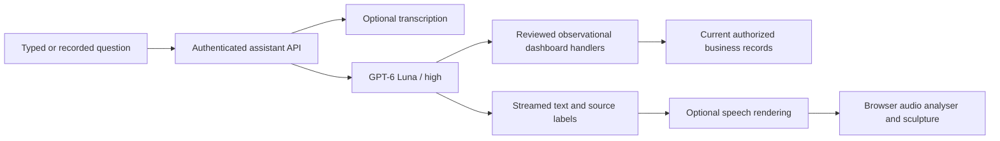

# Global Connects assistant at /ai

The public `/ai` page contains the horizontal voice sculpture and the assistant
workspace. Company data, conversations, files, transcription, narration and image
generation require the existing authenticated administrator session. Initially only
an active **super_admin** may use the data APIs. An administrator using an effective
agency role does not bypass that restriction.

## Request flow and authorization

The assistant calls first-party Python dashboard readers directly. It does not
connect to the desktop MCP connector, use MCP grants, or pass a remote MCP endpoint
to OpenAI. It reuses the reviewed dashboard reader definitions, argument validation,
projection redaction and observational SQL guard from the existing integration.
That reuse preserves the dashboard's business meanings and pagination rules.

Every tool read reloads the account's active role and session version. Group,
passport, hotel, attendance-session and broadcast identifiers must agree with an
explicit agency scope. The observational session rejects business DML, ORM mutations
and commits; only the canonical sensitive-read audit may be committed afterwards.
The assistant exposes no SQL, business-write, provider-send or arbitrary URL tool.

The browser refreshes lightweight connection/agency observations every 30 seconds
while visible. Answers query current stored dashboard observations on demand and
include source labels and observation times. Existing canonical caches and view
pagination remain authoritative. This is not an autonomous monitoring or notification
service, and an observation timestamp is not a guarantee of zero cache age.

## Provider configuration

All credentials stay in the backend environment. No key is requested by the page
or included in browser bundles, files, logs or responses. The feature deliberately
does not inherit `OPENAI_API_KEY` used by other application features.

| Backend environment variable | Prepared value |
| --- | --- |
| `AI_ASSISTANT_OPENAI_API_KEY` | Empty until the operator provisions it securely |
| `AI_ASSISTANT_MODEL` | `gpt-6-luna` |
| `AI_ASSISTANT_REASONING_EFFORT` | `high` |
| `AI_ASSISTANT_TRANSCRIPTION_MODEL` | `gpt-transcribe` |
| `AI_ASSISTANT_SPEECH_MODEL` | Empty until the user selects a voice setup |
| `AI_ASSISTANT_VOICE` | `marin`; `cedar`, `alloy`, `coral`, `sage` are also accepted |
| `AI_ASSISTANT_IMAGE_MODEL` | `gpt-image-2.5-flare` |
| `AI_ASSISTANT_MAX_OUTPUT_TOKENS` | `8192` |
| `AI_ASSISTANT_DAILY_REQUESTS` | `200` per account / UTC day |
| `AI_ASSISTANT_DAILY_IMAGES` | `12` per account / UTC day |
| `AI_ASSISTANT_TIMEOUT_SECONDS` | `120` per provider operation |

Provision the feature-specific secret into the **running backend process**, using
the existing private deployment/secret mechanism. Editing a source checkout's env
file does not change an already running container. Keep the same paused-worker
profile when applying the future credential configuration. Validate with an
administrator's `/api/v1/ai-assistant/status`, one synthetic read question, a short
spoken reply and a generated image. API access/model entitlement and actual provider
behavior remain unverified until a real key is deliberately supplied.

The Luna Responses call fixes `reasoning.effort=high`, disables parallel tool calls,
uses `store=false`, and carries encrypted reasoning state within a tool loop.
There are at most eight model rounds and three function calls per round. The full
typed answer is capped at 32,000 characters. Context includes ten recent exchanges
and at most four recent/current attachments, with a 16 MB native-file budget.
Older context is explicitly described as omitted in the model instructions.

### Speech choices checked on 2026-10-18

The prepared workflow keeps Luna responsible for the answer. `gpt-transcribe`
handles recorded questions; a selected speech renderer speaks completed Luna text.
The browser splits long answers into bounded UTF-8 chunks, prefetches one chunk,
and plays them through an AudioContext unlocked by the user's interaction. The
sculpture samples actual playback RMS. Starting the microphone or stopping speech
cancels playback and the upstream request. Client disconnects cancel server-side
speech work and release admission promptly.

| Choice | Standard USD pricing before tax | Fit |
| --- | --- | --- |
| `gpt-realtime-2.1-mini` narration | $0.60 / million text input tokens; $20 / million audio output tokens | Prepared current economical option; Luna supplies the text |
| `gpt-realtime-2.1` narration | $4 / million text input tokens; $64 / million audio output tokens | Prepared premium current option; Luna supplies the text |
| `gpt-live-1` | $0.05 / active session minute; backend model/tools extra | Native full-duplex option; needs a separate live-session transport |
| `gpt-4o-mini-tts` | $0.60 / million text input tokens; $12 / million audio output tokens | Legacy compatibility option, scheduled retirement January 6, 2027 |

Recorded input with `gpt-transcribe` adds **$0.0045 per input minute**. Realtime
narration here receives text, so its audio-input price does not apply to that
specific path. Native two-way Realtime audio has separate audio-input charges:
$10 / million input audio tokens for Mini and $32 for the larger model. Luna and
image generation are billed separately. No provider requests are made without
the dedicated feature key. No paid provider calls were used for implementation QA.

Official references: [Luna](https://developers.openai.com/api/docs/models/gpt-6-luna),
[transcription](https://developers.openai.com/api/docs/models/gpt-transcribe),
[Realtime Mini](https://developers.openai.com/api/docs/models/gpt-realtime-2.1-mini),
[Realtime](https://developers.openai.com/api/docs/models/gpt-realtime-2.1),
[Live](https://developers.openai.com/api/docs/models/gpt-live-1),
[legacy TTS](https://developers.openai.com/api/docs/models/gpt-4o-mini-tts),
[retirements](https://developers.openai.com/api/docs/deprecations).

## Private persistence and uploads

New records use the existing private object store under
`assistant/v1/accounts/<user UUID>/`. Existing database models, migrations, storage
configuration, object paths and business records are unchanged. The new records
are immutable conditional creates. A rollback to the preceding application simply
stops exposing this new prefix; it does not need a schema downgrade or data removal.

Each completed turn has an exact request record and a chronological index. A
durable pre-provider claim prevents an interrupted submission from being charged
again automatically after a process restart. A completed retry replays the saved
turn; changing a prompt under the same request ID is rejected. An interrupted index
write can be repaired when the completed turn is reopened. Lists use S3 cursors and
inverted timestamps so bounded pages return the newest records first.

Files accept PDF (5 MB), JPEG/PNG/WebP, UTF-8 text/Markdown/CSV/JSON, DOCX and XLSX
(8 MB otherwise), with four attachments per question. Original bytes pass the
existing malware/security service. Images are normalized and metadata removed;
PDFs must be readable and unencrypted. Office archives reject macros, encryption,
oversized expansion, excessive entries and active XML. Spreadsheet formulas and
external links are not executed. Excerpts are capped at 60,000 characters / 128 KiB;
spreadsheets are limited to eight sheets, 500 rows and 30 columns per sheet. The
model receives an explicit excerpt notice. Upload acceptance and rejection use the
existing durable security audit; unavailable scanning/evidence returns a retryable
503. Downloads require the owner's authenticated session and never expose object
keys or signed access capabilities to the model.

The image tool supports one to four new images from a text prompt, through either
ordinary chat or the composer's Create images mode. Images are retained privately
and shown in the expanding viewer, thumbnail strip and paged library. Closing an
image only closes its view. Image editing and deleting library content are not
part of this initial read-only-business release. Generation uses the separate
image model, with its own provider charges and account entitlement requirements.

## Capacity, cancellation and presentation

Redis admission is shared across workers: one active operation per account and
three globally. Quotas are fail-closed and image admission is weighted by count.
Leases last 240 seconds; an operation is bounded to 210 seconds. Provider streams,
file sizes, record sizes, queues and tool outputs have finite limits. SSE uses
12-second heartbeats, a 12-event queue, cancellation propagation and terminal saved
completion events. It does not automatically retry paid operations.

The sculpture uses the same horizontal art on phone and desktop. Idle rendering
keeps gentle image-field motion while skipping heavy particle simulation after
settling. Mobile uses a smaller particle grid and pixel ratio. Hidden scenes stop,
reduced-motion preferences are respected, and WebGL failure retains the image and
working chat/voice controls. The reply tint interpolates continuously, including
speech preparation. The image and particle boundary share a reveal value; growing
rectangle collisions move material outwards before spreading it along the edge.

## Verification and rollout boundary

Anonymous status checks leave the public sculpture and local microphone preview
available without treating a visitor as an expired staff session. Sign in uses the
existing session restoration route and returns to `/ai`. Once an account is
confirmed, coordinated cookie refresh remains enabled for status checks and all
private operations. The backend remains the authorization boundary.

Feature tests cover real synthetic SQL reads, changed records, agency mismatch,
live role revocation, forbidden business mutations, rejected tools, private file
ownership, chronological pagination, immutable/replayed requests, bounded streams,
upload formats and scanner failures, Unicode excerpts, CSRF, pending credentials,
voice cancellation, fixed-origin narration and valid WAV output. Browser tests
exercise typed chat, uploads, history, gallery reveal/close/reopen, actual Web Audio
input/output RMS, transcription-to-chat, denied access, reduced motion and fallback.

An isolated 64 MiB Redis container using the VPS's installed image additionally
proved global capacity, per-account serialization, daily quotas and mixed image
counts. It used synthetic keys, no production database and no provider calls;
all prior containers were retained. A separate MinIO fixture was not started
because its capacity check would exceed the fixed host reserve. Storage behavior
has automated adapter coverage; this is not a claim of a fresh real-MinIO test.

Release through the existing operator Fast lane at the exact current-main SHA.
Keep schema `0141_workspace_branding`, original images/volumes/containers and the
paused email/My Photos profile. The Fast receipt is lower assurance than complete
signed CI image qualification. Verify exact revision, public `/ai`, private API
denial, all-worker readiness and a post-heartbeat-TTL soak before completion.
